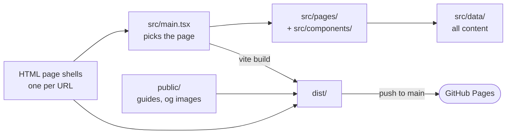

# jaisorgadgets.github.io

Company website for **Jaisor Gadgets LLC**: product showcase, support and
manuals hub, and news. A static multi-page site (Vite, React, TypeScript,
Tailwind CSS v4) deployed to GitHub Pages.

```sh
npm install
npm run dev      # http://localhost:5173
npm run build    # -> dist/
npm run lint
```

## How it fits together



Full diagrams, the folder structure and a "where to edit what" table:
[docs/site-structure.md](docs/site-structure.md).

- Content lives in `src/data/` (products, news, guides, FAQ, policies).
- Contributor and agent guide: [CLAUDE.md](CLAUDE.md). Roadmap: [PLAN.md](PLAN.md).
- Pushes to `main` deploy the live site.

Proprietary. Copyright (c) 2026 Jaisor Gadgets LLC. All rights reserved.
See [LICENSE](LICENSE).
