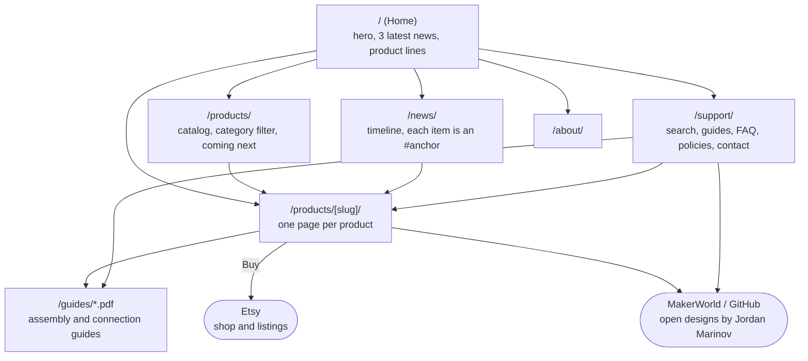
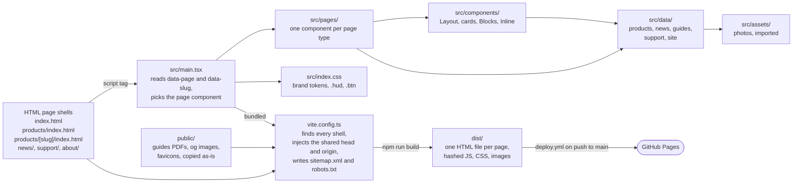
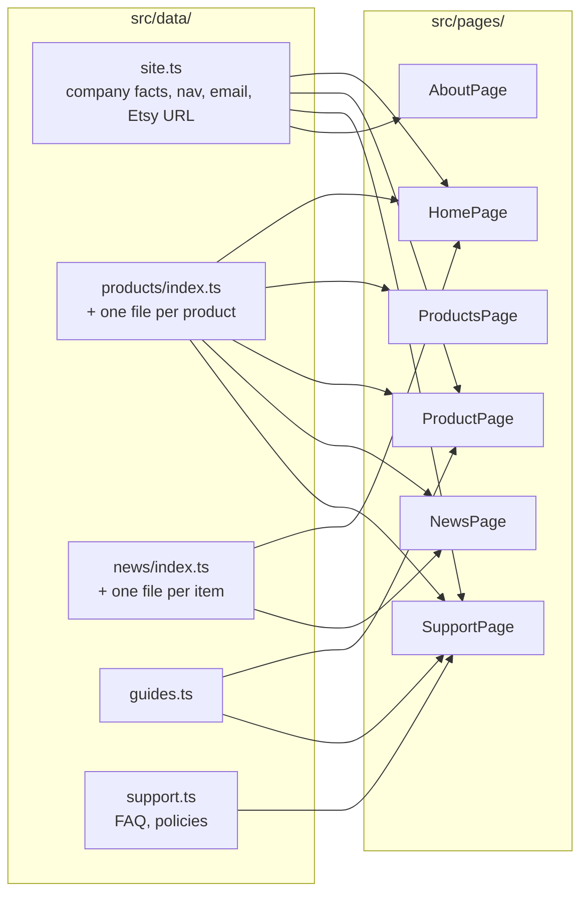

# Site structure

How the Jaisor Gadgets site is organized: the pages a visitor sees, how
the source becomes those pages, and where each file lives. For the rules
on editing content and styling, see [CLAUDE.md](../CLAUDE.md).

## 1. Pages a visitor sees

Every page is a real HTML file at a real URL. There is no client-side
router.



Header and footer (in `Layout.tsx`) link every top-level page from every
page; the diagram shows only the in-page links.

## 2. How the source becomes the site



- `<div id="root" data-page="..." data-slug="...">` in each shell tells
  `main.tsx` what to render. That attribute stands in for a router.
- Product and news files are discovered automatically: drop a file into
  `src/data/products/` or `src/data/news/` and it appears. A product also
  needs its shell under `products/<slug>/`.
- Only `public/` and what `src/` imports reach `dist/`. `docs/`, `assets/`,
  `wireframes/` and the brief never ship.

## 3. Which page reads which data



`Layout` reads `site.ts` too, so every page gets the nav, footer and
contact details from one place.

## 4. Folder structure

```
jaisorgadgetsllc.github.io/
├── index.html                    Home shell
├── products/
│   ├── index.html                Catalog shell
│   └── <slug>/index.html         One shell per product: meta, JSON-LD, data-slug
├── news/index.html               News shell
├── support/index.html            Support shell
├── about/index.html              About shell
│
├── src/
│   ├── main.tsx                  Single entry: data-page → page component
│   ├── index.css                 Brand tokens (@theme), HUD panels, buttons
│   ├── lib/links.ts              linkProps(): new tab + rel for external links
│   ├── pages/                    One component per page type
│   │   ├── HomePage.tsx
│   │   ├── ProductsPage.tsx
│   │   ├── ProductPage.tsx
│   │   ├── NewsPage.tsx
│   │   ├── SupportPage.tsx
│   │   └── AboutPage.tsx
│   ├── components/
│   │   ├── Layout.tsx            Backdrop, header, mobile menu, footer, SectionHeading
│   │   ├── Logo.tsx              Inline SVG mark + wordmark
│   │   ├── ProductCard.tsx       Catalog tile + ProductArt
│   │   ├── NewsCard.tsx          Home-page news teaser
│   │   ├── Blocks.tsx            Renders body blocks (paragraph, list, table, note…)
│   │   ├── Inline.tsx            `code`, [link](href), *bold*, _italic_
│   │   └── NotFound.tsx
│   ├── data/                     ALL site content lives here
│   │   ├── site.ts               Company facts, nav, email, Etsy shop URL
│   │   ├── blocks.ts             Block type for body content
│   │   ├── guides.ts             Guide PDFs (files in public/guides/)
│   │   ├── support.ts            FAQ + policies
│   │   ├── products/
│   │   │   ├── index.ts          Product type, categories, helpers, upcoming ideas
│   │   │   └── <slug>.ts         One product per file, auto-discovered
│   │   └── news/
│   │       ├── index.ts          NewsItem type + helpers
│   │       └── <slug>.ts         One news item per file, auto-discovered
│   └── assets/                   Imported images (fingerprinted at build)
│       ├── home/hero.jpg
│       └── products/<slug>/      card.jpg (4:3) + gallery photos
│
├── public/                       Copied to dist/ unchanged, stable URLs
│   ├── guides/*.pdf              Assembly guides (QR codes may point here)
│   ├── og/<slug>.jpg             1200 × 630 social cards
│   └── favicon.svg, favicon.ico, apple-touch-icon.png
│
├── vite.config.ts                SITE_ORIGIN, page discovery, siteShell() plugin
├── package.json, tsconfig*.json, .oxlintrc.json
├── .github/workflows/deploy.yml  Push to main → lint → build → GitHub Pages
│
├── docs/                         This file (not shipped)
├── assets/                       Logo source PNGs (not shipped)
├── wireframes/WebWire.jpg        Design reference (not shipped)
├── Jaisor-Gadgets-LLC-Website-Context.md   Brief: facts, specs, brand, "do not publish"
├── CLAUDE.md                     Contributor and agent guide
├── PLAN.md                       Roadmap
└── LICENSE                       Proprietary
```

## 5. Where to edit what

| To change | Edit |
| --- | --- |
| Product text, specs, prices, photos | `src/data/products/<slug>.ts` (+ the summary in its shell) |
| A new product | data file, shell, `public/og/<slug>.jpg`, guides: see CLAUDE.md |
| News | add `src/data/news/<slug>.ts` |
| FAQ or policies | `src/data/support.ts` |
| Guide PDFs | `public/guides/` + `src/data/guides.ts` |
| Nav, email, company facts | `src/data/site.ts` |
| Colors, fonts, panel and button styles | `src/index.css` |
| Shared `<head>`, domain, sitemap | `vite.config.ts` |
| Page title, description, social meta | that page's `index.html` shell |
